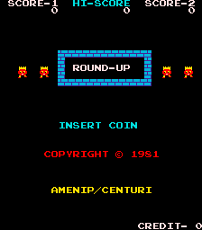
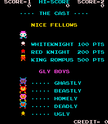
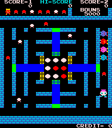

# Round-Up for MiSTer

## Overview

FPGA implementation of **Round-Up**, originally released by Amenip/Centuri.

Current status: functional behavioural implementation, mainly based on MAME/reference behaviour and available arcade hardware documentation.

The core supports the original game's graphics, sound, controls and high-score persistence.

## Screenshots

| | |
| --- | --- |
|  |  |
|  | |

## Installation

1. Copy `releases/Arcade-RoundUp_20261004.rbf` to `/_Arcade/cores/` as `RoundUp_20261004.rbf`. The official Distribution installer removes the `Arcade-` prefix.
2. Copy `releases/Round-Up (Amenip-Centuri, roundup).mra` to `/_Arcade/`.
3. Supply your legally obtained `roundup.zip` in `/games/mame/` and launch the MRA.

**Important:** Move older Round-Up RBFs outside `/_Arcade/cores/` before installing this release to avoid loading the wrong version.

No ROMs are included. The MRA uses the `roundup` ROM set, compatible with the verified MAME 0.268 ROM configuration.

For additional information, see the [MiSTer Arcade ROM guide](https://github.com/MiSTer-devel/Main_MiSTer/wiki/Arcade-Roms).

## Controls and settings

Use the joystick or directional pad for movement.

The core supports Fire, Coin, Start 1P and Start 2P.

During the cube bonus stage, Fire is used to shift the selected row or column of cubes. This particular action has not yet been verified on hardware.

OSD options include:

- Coinage
- Lives
- Cabinet
- Bonus Life
- Orientation
- Save High Score Now

Screen orientation is independent of the game's cabinet and flip settings.

## High-score persistence

The core supports high-score saving through MiSTer's NVRAM system.

The NVRAM file is stored at:

`/media/fat/config/nvram/Round-Up (Amenip-Centuri, roundup).nvm`

To save a qualifying high score:

1. Complete the game and allow the score to register.
2. Open the Round-Up OSD.
3. Wait for the `Saving...` indication to finish.
4. Exit the core normally.

The **Save High Score Now** option allows a manual retry when valid high-score data is available.

High-score saving and replacement have been successfully tested on hardware.

**Important:** Saving requires MiSTer menu servicing. Exiting directly or losing power before the save completes may result in lost scores.

Restoration after a power cycle has not yet been independently verified.

## Credits and licences

**GPL-3.0-or-later covers harlock74's original contributions only.**

Inherited material retains its own terms and notices.

| Component | Credits | Applicable terms / reference |
|---|---|---|
| Round-Up game/video/audio implementation and high-score support | harlock74; inherited contributors where applicable | Scoped [owner grant](LICENSE); inherited terms retained |
| MiSTer integration and framework | MiSTer Template contributors | Retained GPL/LGPL and component-specific notices |
| T80 Z80 CPU | Daniel Wallner, Sorgelig and credited contributors | Original source/synthesized-form conditions retained |
| JT49 sound implementation | Jose Tejada Gomez and contributors | GPL-3.0-or-later; original notices retained |
| PLL and reconfiguration IP | Intel / Altera | Original vendor notices and device-use restrictions |
| Build and test infrastructure | MiSTer Template and project contributors | Original component notices retained |

For complete third-party attribution, licensing details and source provenance, see [NOTICE.md](NOTICE.md), [LICENSE](LICENSE), retained source headers and the accompanying `LICENSES/` directory.

Game ROMs and other copyrighted game assets are not distributed.

## Building the core

The project targets the Cyclone V **5CSEBA6U23I7** FPGA and uses **Quartus Prime Lite 17.0.2 Build 602**.

Open `RoundUp.qpf` in Quartus and select **Full Compilation**.

Alternatively, from the project directory, run:

`quartus_sh --flow compile RoundUp -c RoundUp`

Required source files, IP, constraints and generator scripts are included in the repository.

The supplied release RBF is the previously tested build. A newly compiled RBF should be tested independently before distribution.

**Release SHA-256:**

`Arcade-RoundUp_20261004.rbf`

`58b88d2fe14ccf8c62855a6165acf47288d1c9986e806f2e4449d5afcd0703ce`